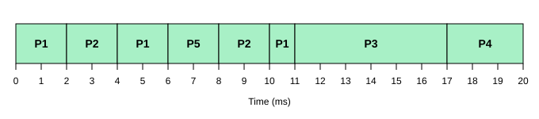
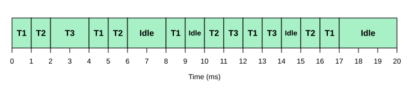

# OS Laboratory Activity 3
## Multilevel Queue and Real-Time CPU Scheduling

### Student Information
- Name: Ma. Regine Bermudo
- Course and Section: BCA151- B186.1
- Instructor: Maria Fe Bahinting
- Date Submitted: November 13, 2026

---

### I. Introduction
This laboratory activity implements and simulates Multilevel Queue (MLQ) scheduling and two real-time scheduling algorithms, Rate Monotonic Scheduling (RMS) and Earliest Deadline First (EDF), using Python. MLQ groups processes into queues with different scheduling policies, while RMS and EDF schedule periodic tasks according to priority and deadline requirements. Gantt charts are used to analyze the execution order, and GitHub is used to manage and document the work.

### II. Objectives
- Explain the operation of Multilevel Queue, RMS, and EDF scheduling.
- Implement MLQ scheduling using Round Robin and FCFS.
- Implement preemptive RMS and EDF simulations in Python.
- Generate and interpret Gantt charts of process and task execution.
- Calculate CPU utilization, waiting time, turnaround time, and deadline compliance.
- Create and manage a GitHub repository containing source code and documentation.

### III. Scheduling Algorithms
1. **Multilevel Queue Scheduling** - Processes are permanently assigned to queues. Queue 1 (interactive) uses Round Robin with a 2 ms quantum; Queue 2 (batch) uses FCFS. Queue 1 has strict priority over Queue 2.
2. **Rate Monotonic Scheduling** - Fixed-priority preemptive scheduling for periodic tasks. The shorter the period, the higher the priority.
3. **Earliest Deadline First** - Dynamic-priority preemptive scheduling. The ready job with the earliest absolute deadline runs first.

### IV. Program Implementation
- **`multilevel_queue/mlq.py`** simulates the CPU in 1 ms steps. Arriving processes are placed in Queue 1 or Queue 2. If Queue 1 has a process, it runs for up to the 2 ms quantum and, if unfinished, goes to the back of Queue 1. Queue 2 runs (FCFS) only when no Queue 1 process is ready, and a Queue 2 process keeps its remaining burst time if interrupted. The program prints the Gantt chart, completion time (CT), turnaround time (TAT = CT - AT), waiting time (WT = TAT - BT), and averages.
- **`real_time_scheduling/rms.py`** treats every periodic release as a separate job with its own release time, absolute deadline, and remaining execution time. Each millisecond it picks, among ready jobs, the one whose task has the shortest period (fixed priority), so a newly released higher-priority job preempts a running lower-priority one. Unfinished jobs are retained, and each job is marked MET, MISSED, or PENDING.
- **`real_time_scheduling/edf.py`** uses the same job model, but each millisecond it picks the ready job with the earliest absolute deadline (ties broken by earlier release, then task ID).

### V. Test Data

**MLQ** (time quantum for Queue 1 = 2 ms)

| Process | Arrival Time (ms) | Burst Time (ms) | Queue |
|---|---|---|---|
| P1 | 0 | 5 | 1 |
| P2 | 1 | 4 | 1 |
| P3 | 0 | 6 | 2 |
| P4 | 2 | 3 | 2 |
| P5 | 3 | 2 | 1 |

**RMS and EDF** (simulation time = 20 ms; all tasks released at time 0)

| Task | Execution Time (C) | Period (T) | Relative Deadline (D) |
|---|---|---|---|
| T1 | 1 ms | 4 ms | 4 ms |
| T2 | 1 ms | 5 ms | 5 ms |
| T3 | 2 ms | 10 ms | 10 ms |

RMS priorities: T1 (T = 4, highest) > T2 (T = 5) > T3 (T = 10, lowest).

### VI. Results and Discussion

#### A. Multilevel Queue

**Gantt chart**



| PID | AT | BT | CT | TAT | WT |
|---|---|---|---|---|---|
| P1 | 0 | 5 | 11 | 11 | 6 |
| P2 | 1 | 4 | 10 | 9 | 5 |
| P3 | 0 | 6 | 17 | 17 | 11 |
| P4 | 2 | 3 | 20 | 18 | 15 |
| P5 | 3 | 2 | 8 | 5 | 3 |

**Average Turnaround Time = 12.0 ms**
**Average Waiting Time = 8.0 ms**

Discussion: All Queue 1 processes (P1, P2, P5) finish by 11 ms and share the CPU in Round Robin order with a 2 ms quantum. P3 arrived at time 0 but could not start until 11 ms because Queue 1 always has priority. P4 (Queue 2) then runs after P3 under FCFS. As a result, the interactive processes have a lower average waiting time (P1 = 6, P2 = 5, P5 = 3) than the batch processes (P3 = 11, P4 = 15). In this data set the Queue 1 backlog lasts until 11 ms, so the Queue 2 processes never actually start before being preempted; the priority rule is shown by Queue 2 waiting until Queue 1 is empty.

#### B. Rate Monotonic Scheduling

CPU Utilization: U = 1/4 + 1/5 + 2/10 = **65%**
RMS sufficient bound for n = 3: 3(2^(1/3) - 1) = **77.98%**
Since 65% < 77.98%, the task set **passes** the sufficient-bound test.

**Gantt chart**



| Task | Release | Deadline | Completion | Status |
|---|---|---|---|---|
| T1 | 0 | 4 | 1 | MET |
| T2 | 0 | 5 | 2 | MET |
| T3 | 0 | 10 | 4 | MET |
| T1 | 4 | 8 | 5 | MET |
| T2 | 5 | 10 | 6 | MET |
| T1 | 8 | 12 | 9 | MET |
| T2 | 10 | 15 | 11 | MET |
| T3 | 10 | 20 | 14 | MET |
| T1 | 12 | 16 | 13 | MET |
| T2 | 15 | 20 | 16 | MET |
| T1 | 16 | 20 | 17 | MET |

**Deadline misses: 0.** The T3 job released at 10 ms is preempted at 12 ms by the higher-priority T1 job and resumes at 13 ms, finishing at 14 ms, still before its deadline of 20 ms.

#### C. Earliest Deadline First

CPU Utilization: **65%**. Classical EDF test (U <= 100%): **PASS**.

**Gantt chart**


| Task | Release | Deadline | Completion | Status |
|---|---|---|---|---|
| T1 | 0 | 4 | 1 | MET |
| T2 | 0 | 5 | 2 | MET |
| T3 | 0 | 10 | 4 | MET |
| T1 | 4 | 8 | 5 | MET |
| T2 | 5 | 10 | 6 | MET |
| T1 | 8 | 12 | 9 | MET |
| T2 | 10 | 15 | 11 | MET |
| T3 | 10 | 20 | 14 | MET |
| T1 | 12 | 16 | 13 | MET |
| T2 | 15 | 20 | 16 | MET |
| T1 | 16 | 20 | 17 | MET |

**Deadline misses: 0.** At 12 ms, T1's new job (deadline 16) has an earlier absolute deadline than T3's job (deadline 20), so EDF runs T1 first, then resumes T3.

**Note:** For this particular task set, RMS and EDF produce the same schedule, because whenever two jobs compete, the job from the shorter-period task also happens to have the earlier absolute deadline. The algorithms differ in how they decide (fixed period priority vs. deadline), and they can produce different schedules on other task sets, especially at high utilization.

### VII. Algorithm Comparison

| Criteria | MLQ | RMS | EDF |
|---|---|---|---|
| Scheduling basis | Queue priority | Task period | Absolute deadline |
| Priority assignment | Fixed queue priority | Fixed task priority | Dynamic task priority |
| Scheduling type | Depends on queue policy | Preemptive | Preemptive |
| Main application | Process classification | Periodic real-time tasks | Deadline-based real-time tasks |
| Deadline monitoring | Not inherent | Yes | Yes |

### Guide Questions

**1. What is the main difference between Multilevel Queue and Multilevel Feedback Queue scheduling?**
```In MLQ, a process is permanently assigned to one queue and never moves. In Multilevel Feedback Queue, processes can move between queues based on their behavior (for example, a process that uses too much CPU time is demoted, and a process that waits too long is promoted to prevent starvation).```

**2. Why does MLQ use different scheduling algorithms for different process queues?**
```Different process types have different needs. Interactive processes need fast response time, so Round Robin with a small quantum suits them. Batch processes need throughput and low overhead and do not need immediate response, so simple FCFS is enough. Using one policy per queue lets the system serve each group appropriately.```

**3. How does RMS determine which task receives the CPU first?**
```RMS gives the CPU to the ready task with the shortest period (highest rate). In this lab, T1 (4 ms) goes first, then T2 (5 ms), then T3 (10 ms).```

**4. Why is RMS considered a fixed-priority scheduling algorithm?**
```Priorities are assigned once, before execution, based only on task periods. They never change at run time, and every job of a task always has the same priority.```

**5. How does EDF determine which task should execute next?**
```EDF looks at all ready jobs and runs the one with the earliest absolute deadline (release time + relative deadline).```

**6. Why is EDF considered a dynamic-priority scheduling algorithm?**
```A job's priority depends on its absolute deadline, which changes as new jobs are released. The same task can have a higher priority at one moment and a lower priority at another, so priorities are recalculated during execution.```

**7. What happens when a newly released task has an earlier deadline than the currently running task under EDF?**
```The new task preempts the running task. The preempted task keeps its remaining execution time and returns to the ready queue, resuming later when it again has the earliest deadline (as seen with T3 at 12 ms in the EDF output).```

**8. Why is CPU utilization important in real-time scheduling?**
```Utilization (the sum of Ci/Ti) shows how much of the processor's capacity the task set demands. It is used in schedulability tests: if utilization exceeds 100%, the task set cannot be scheduled by any algorithm on one processor, and for RMS it must be within the bound for guaranteed schedulability. It also shows how much spare capacity remains.```

**9. Can a task set with CPU utilization below 100% still miss a deadline? Explain the conditions under which this may happen.**
```Yes. Under RMS, utilization above the sufficient bound (about 69% to 78% depending on n) is not guaranteed schedulable, and some sets do miss deadlines. Example: T1 (C = 2, T = 5) and T2 (C = 4, T = 7) have U = 97.1% and RMS makes T2 miss its first deadline at 7 ms. Deadlines can also be missed when relative deadlines are shorter than periods, when tasks are non-preemptible or share resources (blocking), when context-switch overhead is not ignored, or when scheduling on multiple processors. Under ideal EDF (single processor, preemptive, independent tasks, D = T), U <= 100% is enough, so misses would only come from those violated assumptions.```

**10. Which algorithm would you recommend for periodic real-time tasks, RMS or EDF? Justify your answer.**
```I would recommend EDF when the goal is the best use of the CPU, since it can schedule any task set up to 100% utilization, while RMS is only guaranteed up to about 69-78%. RMS is a good choice when simplicity and predictability matter: its fixed priorities are easy to implement and analyze, and under overload the low-priority tasks fail first in a predictable way, whereas under EDF overload misses are harder to predict. For the task set in this lab (65% utilization), both met every deadline and produced the same schedule.```

### VIII. Conclusion
In this activity I implemented MLQ, RMS, and EDF scheduling simulations in Python and used Gantt charts to analyze their behavior. I learned how MLQ prioritizes queues and applies a different policy to each, how RMS uses fixed priorities based on period, and how EDF uses dynamic priorities based on absolute deadlines. I calculated turnaround time, waiting time, CPU utilization, and deadline compliance, and verified that the real-time task set met all of its deadlines under both RMS and EDF.
